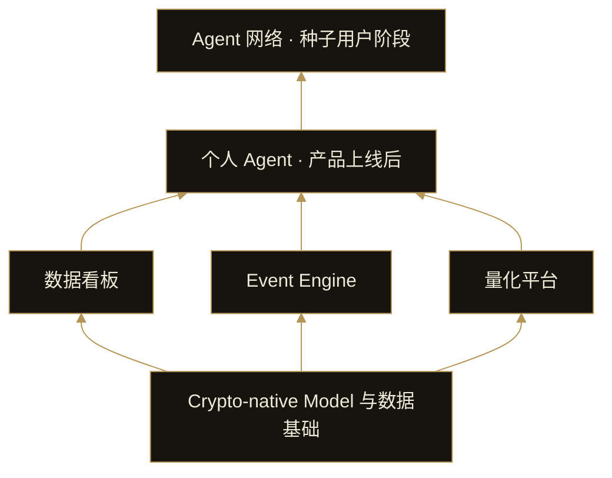

# 3. 产品架构

DI 的架构围绕共同的模型基础、三类产品能力，以及后续的个人 Agent 与 Agent 网络展开。模型提供共享基础，产品提供具体工作能力，个人 Agent 将能力组织到用户任务中，网络再连接不同用户的 Agent。

## 共同基础，三类产品

数据看板、Event Engine 和量化平台承担不同工作，并共享加密市场的数据与模型基础。用户可以单独使用其中一项，也可以按任务组合不同能力。

看板可独立用于信息发现；Event Engine 可从用户直接提出的问题开始；量化平台既提供 DI 自有产品，也为用户创建和发布策略产品提供工具。

## 个人 Agent 是用户的调用入口

在后续阶段，个人 Agent 将根据用户任务调用这些能力。一个任务可以只需要监测数据，也可以同时需要事件研究和策略分析。Agent 将组织任务与上下文，并调用底层产品能力。

## 网络连接不同用户的 Agent

Agent 网络将在个人 Agent 形成后逐步建立。其核心关系是 Agent 之间的通信、信息交换、能力调用和协同任务。

Event Engine 中的多角色讨论围绕一次研究问题展开；金融 Agent 网络则连接持续服务于不同用户的 Agent，支持跨用户的能力调用与协作。
