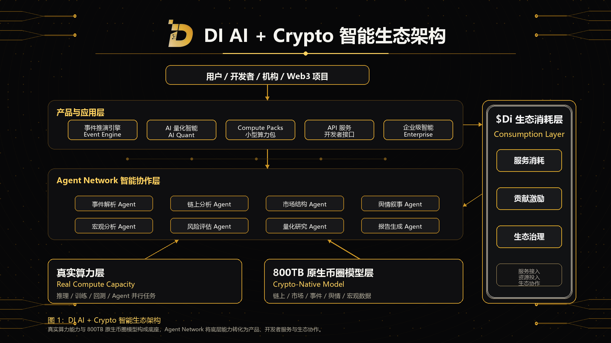

DI 的生态架构由六个组成部分构成：用户与生态参与者、产品与应用层、Agent Network、模型与数据层、真实算力层，以及贯穿系统的生态消耗与协作机制。

## 用户与生态参与者

DI 面向多类用户开放，包括普通用户、开发者、研究员、交易团队、Web3 项目方、机构客户、数据贡献者、模型贡献者和 Agent 构建者。

不同角色通过不同入口使用 DI。普通用户可以使用 Event Engine 发起事件推演；研究员可以使用 AI Quant Intelligence 进行市场结构研究；开发者可以通过 API 和 Compute Packs 构建应用；项目方和机构可以接入企业级智能服务；生态贡献者可以围绕数据、模型、Agent 和历史复盘提供贡献。

## 产品与应用层

产品与应用层负责把底层能力转化为可使用的产品。

这一层包括 Event Engine、AI Quant Intelligence、Compute Packs、API Services 和 Enterprise Intelligence。它们分别服务于事件推演、量化研究、算力消耗、开发者接入和机构级需求。

## Agent Network

Agent Network 是 DI 的智能协作层。

复杂事件通常无法由单一模型一次性完成判断。Agent Network 会将任务分配给不同专业 Agent，例如事件解析 Agent、链上分析 Agent、市场结构 Agent、舆情叙事 Agent、宏观分析 Agent、风险评估 Agent、量化研究 Agent 和报告生成 Agent。

这些 Agent 可以并行执行，也可以在任务中相互校验，最终形成更完整的智能输出。

## 模型与数据层

模型与数据层由 800TB 原生币圈模型支撑。

该模型不是通用数据的简单堆叠，而是围绕加密市场长期积累的原生数据和结构化语境构建，包括链上行为、市场数据、历史事件、项目数据、舆情叙事、宏观变量、安全事件和跨市场信号。

## 真实算力层

真实算力层是 DI 的底座。

它支撑模型推理、训练、回测、数据处理、历史检索、Agent 并行任务、API 调用和企业级智能服务。DI 将真实算力能力通过产品化方式交付给用户，而不是把算力本身作为唯一产品叙事。

## 生态消耗与协作机制

生态消耗与协作机制连接服务使用、资源投入、贡献激励和治理协作。

随着 DI 产品和开发者生态扩展，系统将围绕真实服务消耗、真实贡献记录和真实生态协作形成长期循环。
