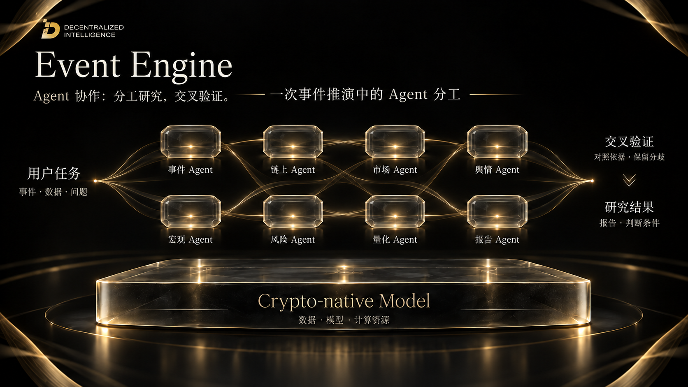
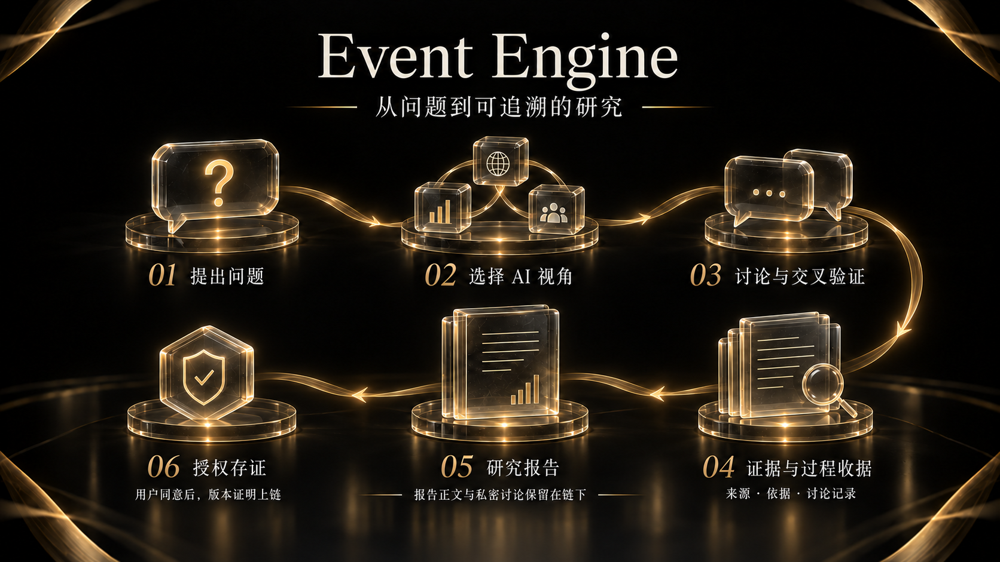

# 6. Event Engine

Event Engine 从一个关于市场、宏观或加密资产的问题开始，通过 AI 模拟的不同分析视角展开讨论，并将依据、分歧与过程一起保留。它的产出是一份可以回看研究过程的推演报告。

## 多视角研究

用户提出问题后，可以选择不同的 AI 角色参与研究。角色模拟 KOL 的表达风格与分析视角，让同一问题呈现不同的关注点和解释方式。这不代表对应 KOL 本人参与或背书。

研究包含独立观点与交叉讨论，同时保留共识、分歧和不确定性。

## Agent 分工与交叉验证

一次事件推演可以围绕事件背景、链上行为、市场结构、舆情、宏观环境、风险和量化分析分配研究任务，由报告 Agent 汇总研究结果。各类 Agent 交换信息、对照来源，保留不同解释与判断条件。

## 证据与过程收据

研究中的引用保留出处，并区分事实、推断与待核实项。过程收据与阶段记录用于回看某一步产生了什么结果，以及报告如何从问题发展到最终判断。

过程收据记录研究步骤，引用提供论点依据，用户可以结合两者回看报告的形成过程。

## 推演报告

报告汇总主要判断、阶段影响、风险与失效条件。失效条件说明哪些变化会使原判断需要重新评估，使报告可以随着事件发展被回看和修正。

不同视角可以提出相反解释。报告呈现各方观点的依据和信息缺口，帮助用户理解结论的适用范围。

## 授权与链上存证

经用户授权，指定报告版本的凭证可以记录到链上。报告正文和私有讨论保留在链下。链上记录用于核验指定版本的凭证。
