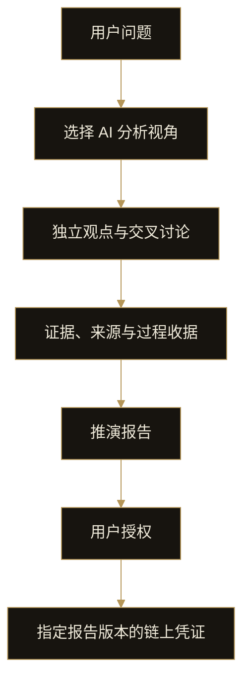

# 6. Event Engine

Event Engine 从一个关于市场、宏观或加密资产的问题开始，通过 AI 模拟的不同分析视角展开讨论，并将依据、分歧与过程一起保留。它的产出是一份可以回看研究过程的推演报告。

## 多视角研究

用户提出问题后，可以选择不同的 AI 角色参与研究。角色模拟 KOL 的表达风格与分析视角，让同一问题呈现不同的关注点和解释方式。这不代表对应 KOL 本人参与或背书。

讨论包含独立观点与交叉讨论。系统需要保留共识，也保留尚未解决的分歧，而不是为了形成单一答案而省略不确定性。

## 证据与过程收据

研究中的引用应保留出处，并区分事实、推断与待核实项。过程收据与阶段记录用于回看某一步产生了什么结果，以及报告如何从问题发展到最终判断。

收据记录的是过程，引用记录的是依据，两者都不能单独证明某个判断正确。它们让用户能够重新检查研究，而不是只看到一个无法追溯的结果。

## 推演报告

报告汇总主要判断、阶段影响、风险与失效条件。失效条件说明哪些变化会使原判断需要重新评估，使报告可以随着事件发展被回看和修正。

不同视角可以提出相反解释。报告应呈现支撑各方观点的依据，以及仍然缺少哪些信息，帮助用户理解结论的适用范围。

## 授权与链上存证

经用户授权，指定报告版本的凭证可以记录到链上。报告正文和私有讨论保留在链下。链上记录用于核验版本凭证与记录关系，不代表公开全部研究内容，也不证明预测正确或收益实现。
