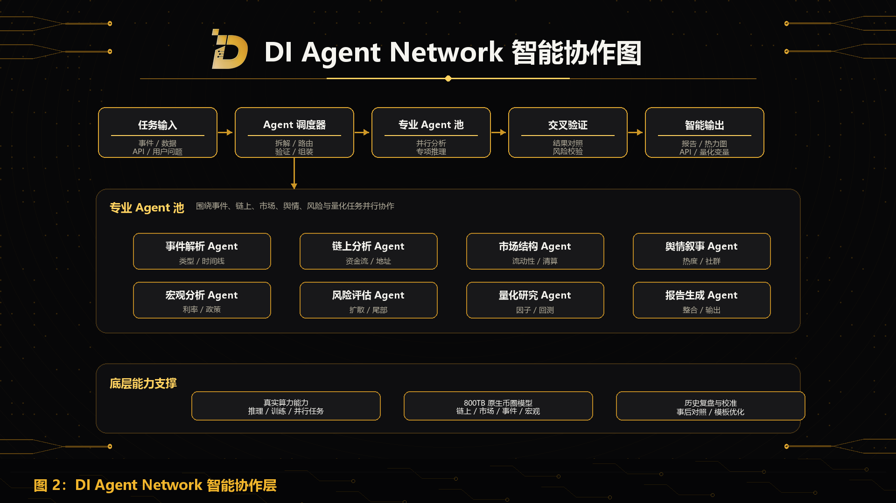

Agent Network 是 DI 将复杂任务转化为可执行智能工作流的协作层。

在加密市场中，单一模型很难同时完成事件理解、链上分析、市场结构判断、舆情识别、宏观分析、风险评估、量化研究和报告生成。DI 通过 Agent Network 将这些任务拆分给不同专业 Agent，并通过统一工作流进行编排。

## Agent 类型

DI 的 Agent Network 可以包括以下角色：

- 事件解析 Agent：识别事件类型、时间窗口、参与方、直接影响和潜在传导路径；
- 链上分析 Agent：分析资金流、地址行为、协议交互、稳定币流向和异常链上活动；
- 市场结构 Agent：分析流动性、杠杆、衍生品、清算风险、订单簿和相关性；
- 舆情叙事 Agent：识别新闻、社交媒体、社区讨论和市场叙事变化；
- 宏观分析 Agent：分析利率、美元流动性、地缘政治、监管和风险资产环境；
- 风险评估 Agent：评估尾部风险、扩散路径、敏感资产和关键监控指标；
- 量化研究 Agent：将事件变量转化为研究因子、回测对象和监控指标；
- 报告生成 Agent：整合多 Agent 输出，生成报告、矩阵、热力图和 API 结果。

## 协作方式

Agent Network 通过任务拆解、并行执行、交叉验证和结果整合完成复杂工作流。

在 Event Engine 中，系统会先将事件结构化，再将不同任务分配给对应 Agent。各 Agent 独立分析后，系统会进行结果对齐、冲突识别、权重调整和最终输出。

这种机制使 DI 能够在复杂市场事件中同时处理多个维度，而不是依赖单一路径输出。

## 持续进化

Agent Network 会随着数据、模型、产品和生态贡献不断进化。

新的 Agent 可以围绕稳定币、交易所、RWA、DeFi、Layer2、NFT、GameFi、安全、监管、宏观和多语言舆情等方向扩展。贡献者也可以基于 DI 的框架构建专业 Agent，使 DI 能力覆盖更多市场场景。
