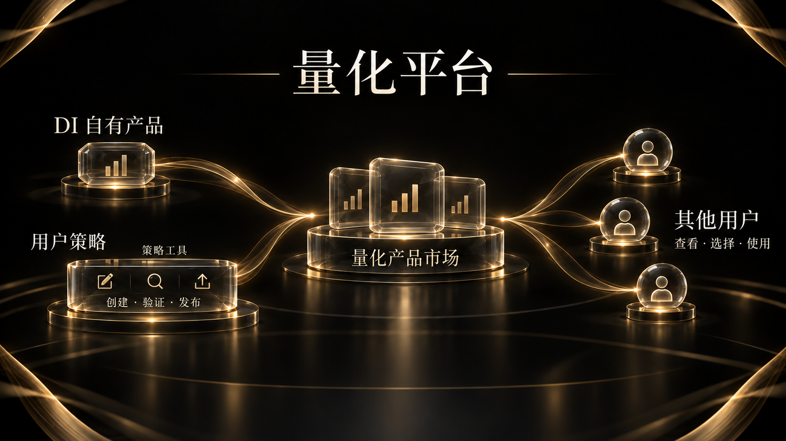

# 7. 量化平台

DI 的量化平台连接策略研究、产品创建与产品使用。平台提供 DI 自有量化产品，也让用户通过工具将自己的策略做成产品，上架供其他用户使用。

## DI 自有量化产品

用户可以了解 DI 产品的策略逻辑、产品表现和风险，选择适合自己研究与使用需求的产品。动态篮子是其中一类产品。

产品信息包括策略目标、规则与表现，便于用户结合市场环境进行评估。

## 用户创建与发布

策略创建工具帮助用户将想法表达为可研究、可测试的规则。创建者可以围绕数据、变量与策略条件开展验证，再形成供其他用户理解和使用的产品。

创建者通过策略说明、适用条件与风险信息介绍产品，并持续跟踪产品表现。使用者可以据此了解策略逻辑，评估是否适合自己的需求。

## 量化产品市场

市场汇集 DI 和其他创建者的产品，使用户可以比较策略说明、表现与风险，再决定是否使用。平台的价值既来自自有产品，也来自让更多策略成为可供他人使用的产品。

平台从量化产品利润中按约定比例获得分成。具体产品的参与方式、费用与使用条件以产品说明为准。

## 与研究工具衔接

数据看板提供市场线索，Event Engine 提供事件情景与判断条件，量化工具帮助用户研究这些条件能否形成规则。事件研究与策略结果可以相互检验，但研究结论不会自动等于可执行策略。
