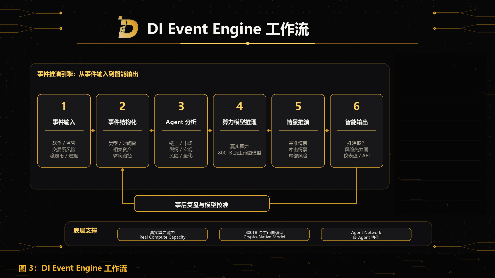

Event Engine 是 DI 的第一个旗舰产品入口，也是 DI 将真实算力、800TB 原生币圈模型和 Agent Network 转化为用户可感知智能服务的核心场景。

它将真实算力能力、800TB 原生币圈模型和 Agent Network 结合起来，用于分析加密市场中的复杂事件，并输出结构化的事件推演、风险分析和智能结果。

Event Engine 是 DI 生态能力的第一个集中展示场景。它让用户能够看到 DI 如何将底层算力、原生数据、模型推理和 Agent 协作转化为可使用的 AI 产品。

## 事件输入

Event Engine 支持用户主动输入和系统自动捕捉两类事件来源。

用户可以围绕已发生、正在发生或假设中的事件提出问题，例如：

- 某地区爆发战争后，BTC、ETH、稳定币和风险资产可能受到什么影响；
- 主要交易所发生流动性危机后，风险可能如何扩散；
- 稳定币出现脱锚信号时，哪些指标需要持续监控；
- 某国家发布新的加密监管政策后，哪些赛道可能受到影响；
- 跨链桥发生攻击后，相关链和协议会面临什么风险。

系统也可以通过新闻、链上数据、交易所数据、稳定币流向、衍生品指标、社交舆情和安全事件监控，识别潜在市场异常和事件信号。

## 事件结构化

事件进入系统后，Event Engine 会先将其结构化。

系统会识别事件类型、时间窗口、涉及地区、相关资产、相关协议或机构、直接影响路径、间接传导路径、关键监控指标和潜在风险级别。

结构化的目的，是把一个模糊事件转化为可以被 Agent Network、模型和算力系统处理的任务。

## Agent 分析

事件结构化后，Agent Network 会围绕不同维度进行并行分析。

事件解析 Agent 负责拆解事件本身；链上分析 Agent 观察资金流和地址行为；市场结构 Agent 分析流动性、杠杆和清算风险；舆情叙事 Agent 识别市场情绪和叙事扩散；宏观分析 Agent 判断利率、美元、监管和地缘政治影响；风险评估 Agent 识别尾部风险和传导路径；量化研究 Agent 将事件变量转化为可研究指标；报告生成 Agent 负责整合输出。

这种多 Agent 协作机制，使 Event Engine 能够通过多维度分析和交叉验证生成更完整的事件智能。

## 算力与模型推理

Event Engine 的推演过程由真实算力能力和 800TB 原生币圈模型支撑。

真实算力能力用于模型推理、并行 Agent 执行、数据处理、历史事件检索、情景模拟和报告生成。800TB 原生币圈模型为系统提供加密市场上下文，包括链上行为、市场结构、历史事件、项目数据、舆情叙事、宏观变量和跨市场信息。

## 多情景推演

Event Engine 不依赖单一路径输出，而是围绕多个情景进行推演。

常见情景包括基准情景、冲击情景、严重情景和尾部风险情景。

例如，在地缘政治冲突场景中，系统可以分析冲突轻微、冲突升级、宏观市场联动、市场情绪恶化等不同路径下，BTC、ETH、稳定币、黄金叙事资产和风险资产可能出现的反应。

这种多情景推演方式，可以帮助用户理解不同路径下的市场风险和变量变化。

## 智能输出

Event Engine 的直接输出包括事件推演报告、风险热力图、资产影响矩阵、关键监控指标和动态仪表盘。

对开发者和机构客户，这些能力也可以通过 API Services 或 Enterprise Intelligence 被集成到外部系统、研究流程、风控面板和企业级工作流中。因此，Event Engine 是事件智能能力的产品入口，而 API Services 与 Enterprise Intelligence 是能力分发和集成入口。

## 事后复盘与模型校准

事件结束后，DI 会进行事后复盘。

系统会将真实市场表现与此前推演结果进行对比，评估哪些判断有效，哪些路径发生偏差，哪些数据源或 Agent 表现更稳定，哪些模型权重和情景模板需要调整。

复盘结果会用于优化数据源权重、模型参数、Agent 表现、情景模板、风险阈值和事件分类体系。

这让 Event Engine 不只是一次性分析工具，而是一个可以随着市场事件持续进化的事件智能系统。
