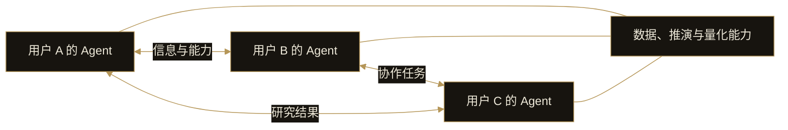

# 10. 金融 Agent 网络

DI 的金融 Agent 网络连接服务于不同用户的 Agent。网络的价值来自 Agent 之间的信息流动、能力调用和任务协作，使每个用户的智能体团队能够接入更广泛的研究与策略能力。

## 信息交换

一个 Agent 发现的市场事件，可以成为其他 Agent 进一步研究的线索。信息交换需要保留来源、时间和上下文，让接收方判断它与当前任务是否相关。

Agent 之间形成共识并不自动证明结论正确。网络仍然需要面对来源质量、重复信息和观点相互影响的问题。

## 能力调用

Agent 可以围绕任务调用其他 Agent 提供的数据、研究或策略能力。不同 Agent 不必承担完全相同的工作；其能力可以相互补充。

这种互通将产品能力带到更大的任务范围中。调用的价值取决于返回结果是否能支持发起任务的 Agent 继续工作，而不是单纯增加参与的 Agent 数量。

## 协同完成任务

多个 Agent 可以围绕同一问题分工，分别研究不同方面，再将结果返回给发起任务的 Agent。用户通过自己的 Agent 接入这些工作，而不是逐个操作网络中的所有节点。

## 从种子网络开始

DI 将以 **2,000 个创始 NFT 对应的种子用户**建立首个网络。重点是让真实任务中的通信、能力调用和协作形成可使用的关系，再逐步扩展。

2,000 表示创始 NFT 的数量，不直接等于独立用户数、已运行 Agent 数或网络活跃度。首个网络属于个人 Agent 之后的发展阶段。

网络互通也不意味着公开用户全部资料。信息共享与任务调用应遵守用户授权，私有研究内容与可共享结果需要有明确边界。
