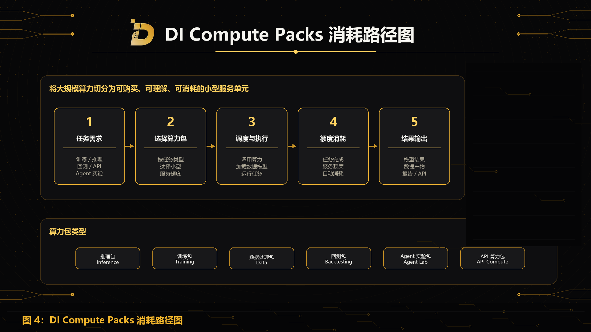

Compute Packs 是 DI 面向开发者、研究员、AI 构建者、小型团队，以及具备明确任务需求的高阶个人用户提供的小型算力服务额度。

它的目标，是将底层真实算力能力切分为可购买、可理解、可执行、可消耗的小型服务单元，让更多用户能够以更低门槛使用 AI 算力。

在传统场景下，AI 算力往往以大型服务器、云资源、复杂计费、长期租用或企业级服务的形式存在。对于个人研究员、开发者、小团队和早期项目来说，直接使用这些资源存在较高门槛。

DI 通过 Compute Packs 降低这一门槛。

用户不需要理解复杂的底层算力调度，也不需要长期租用大规模资源。用户只需要根据自己的任务选择适合的算力包，系统会完成调度、执行和消耗。

## Compute Packs 是什么

Compute Packs 是可消耗的算力服务额度。

每一个 Compute Pack 对应一种或一组任务能力，例如模型推理、模型训练、数据处理、量化回测、Agent 实验或 API 调用。

用户购买 Compute Pack 后，可以用它完成特定计算任务。任务执行完成后，对应服务额度会被消耗。

例如，一个推理包可以用于完成一批模型推理任务；一个训练包可以用于完成某个小型模型训练或微调任务；一个数据处理包可以用于清洗、索引或分析某批数据；一个回测包可以用于运行某次量化研究回测任务；一个 Agent 实验包可以用于测试一个多 Agent 工作流；一个 API 算力包可以用于一定数量的 API 调用任务。

## 与 Event Engine 的用户路径区别

Compute Packs 与 Event Engine 面向不同使用路径。

Compute Packs 不是 Event Engine 的用户付费方式，也不是普通用户使用事件推演时必须理解的底层资源。

Event Engine 用户购买的是托管式 AI 事件智能结果。用户支付服务费用，发起事件推演任务，并获得报告、风险热力图、资产影响矩阵、监控指标或动态仪表盘，不需要直接选择算力规格，也不需要理解底层用了多少计算资源。

Compute Packs 用户购买的是可用于训练、推理、数据处理、回测、Agent 实验或 API 批量任务的计算额度。

它面向的是另一类用户：个人研究员、开发者、小团队、AI 构建者和 Web3 项目方。他们可以以更低门槛直接调用 DI 的部分算力能力，用于自己的训练、推理、数据处理、回测、Agent 实验或开发者任务。

因此，Event Engine 是面向终端用户的 AI 事件智能服务；Compute Packs 是面向开发者和高阶用户的自助式算力服务额度。

## 使用流程

Compute Packs 的使用流程可以分为五步。

第一，用户提出任务需求，例如模型推理、小型训练、数据清洗、量化回测、Agent 工作流实验或 API 批量调用。

第二，系统根据任务类型提供不同规格和用途的 Compute Pack。

第三，用户确认任务后，DI 进行底层算力调度，并根据任务需要加载相关数据、模型、Agent 或 API 服务。

第四，任务执行过程中消耗对应服务额度。

第五，任务完成后，用户获得对应结果，例如模型输出、数据处理结果、回测结果、Agent 实验结果、报告或 API 返回数据。

## Compute Packs 类型

DI 可以根据不同任务类型设计多种 Compute Pack。

- Inference Pack / 推理包：用于模型推理、文本分析、事件摘要、市场解释、报告生成和 API 推理任务。
- Training Pack / 训练包：用于小型模型训练、微调、参数优化或特定数据集上的模型实验。
- Data Processing Pack / 数据处理包：用于数据清洗、格式转换、索引、标签生成、链上数据处理和历史事件结构化。
- Backtesting Pack / 回测包：用于量化研究、事件因子测试、策略研究、压力测试和风险暴露分析。
- Agent Lab Pack / Agent 实验包：用于构建、测试和运行多 Agent 工作流。
- API Compute Pack / API 算力包：用于开发者 API 调用、批量任务执行、自动化工作流和第三方应用集成。

## 产品价值

Compute Packs 的价值在于降低 AI 算力使用门槛。

它让用户不需要一次性购买或租用复杂算力资源，也不需要面对企业级基础设施配置，而是可以根据具体任务按需使用小型算力服务。

这对于个人研究员、独立开发者、小型量化团队、Web3 项目方、AI Agent 构建者、安全研究团队、数据贡献者和早期生态开发者尤其重要。

Compute Packs 的核心定位是：小型化、任务化、可消耗的 AI 算力服务额度。
