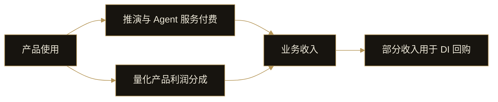

# 14. 商业模式

DI 的商业模式围绕产品使用形成服务收入，并通过量化产品利润分成增加收入来源。部分业务收入用于 DI 回购。

## 收入从哪里产生

Event Engine 的推演服务、个人 Agent 的任务与工具调用，以及网络中的服务和协作任务，构成服务付费场景。这些收入随对应产品能力和服务阶段逐步形成。

量化产品提供另一类收入来源：平台按约定比例分享产品利润。产品利润分成与固定服务收费不同，取决于具体产品的表现和约定，不应直接按产品额度推算收入。

数据看板的持仓资格则是产品访问机制，不能将用户持有的 DI 总额直接记为平台收入。

## 产品使用与回购

这个机制将产品需求与商业收入连接起来。产品是否持续有用、用户是否愿意使用，以及量化产品能否产生可分成利润，都会影响收入。

## 阶段与披露

当前阶段聚焦已完成的产品构建与后续上线。个人 Agent 和网络的收入场景依赖对应阶段的实现，不将未来用途写成现有营收。

本白皮书说明收入结构，不列示未经披露的实际收入、回购规模或收益预测。界面演示中的产品额度与收益数字也不作为业务收入证明。

随着产品运营推进，服务使用、产品表现与实际回购应分别披露，避免将交易次数、活动参与或来源覆盖数当作收入。
