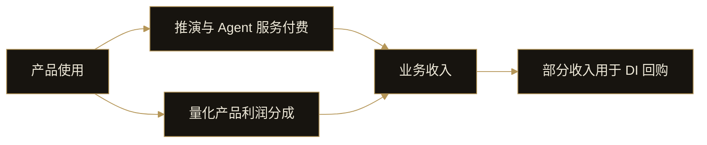

# 14. 商业模式

DI 的商业模式围绕产品使用形成服务收入，并通过量化产品利润分成增加收入来源。部分业务收入用于 DI 回购。

## 收入从哪里产生

Event Engine 的推演服务、个人 Agent 的任务与工具调用，以及网络中的服务和协作任务，构成服务付费场景。这些收入随对应产品能力和服务阶段逐步形成。

量化产品提供另一类收入来源：平台按约定比例分享产品利润。利润分成取决于具体产品的表现和约定。

数据看板通过持有 DI 获得访问资格；业务收入来自服务支付与量化产品利润分成。

## 产品使用与回购

这个机制将产品需求与商业收入连接起来。产品是否持续有用、用户是否愿意使用，以及量化产品能否产生可分成利润，都会影响收入。

## 随产品发展拓展收入场景

DI 已完成产品构建，接下来推进上线。推演服务与量化产品构成初期业务基础；个人 Agent 和网络将进一步拓展任务执行、工具调用与协作服务的付费场景。
