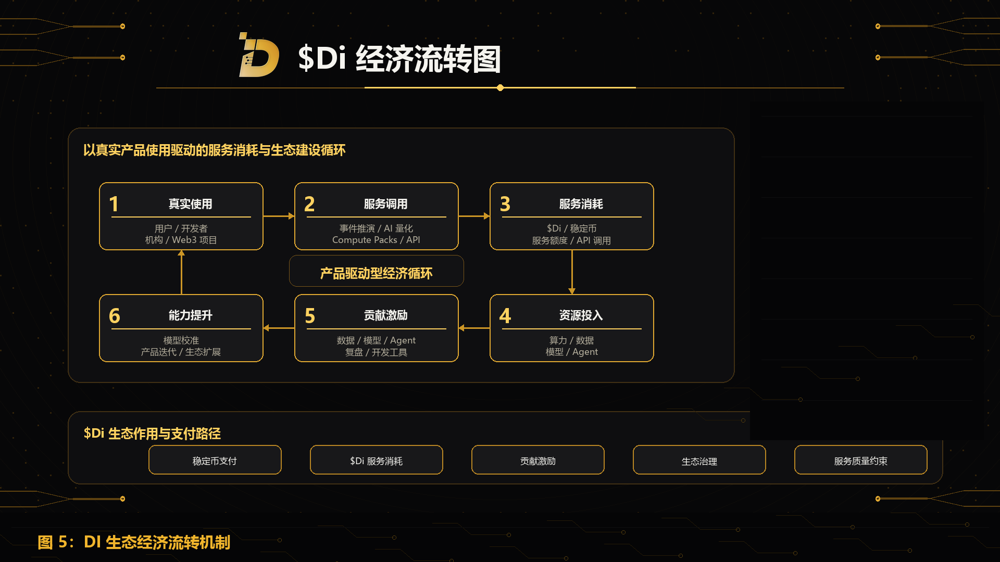

DI 的经济流转机制围绕真实服务消耗、算力资源投入、贡献激励、生态治理和长期金库管理展开。

DI 的商业闭环从真实产品使用开始。用户通过 Event Engine、AI Quant Intelligence、Compute Packs、API Services 和 Enterprise Intelligence 产生服务消耗；服务消耗形成资源回流，继续支持算力、数据、模型、Agent、产品研发和生态任务；更强的底层能力带来更好的产品体验，也带来更多可验证贡献场景。

## 双支付路径

DI 支持稳定币与 $Di 两类支付路径。

稳定币支付用于降低用户进入门槛，方便普通用户、企业客户、开发者和机构直接购买服务。$Di 支付用于强化生态原生消耗路径，使服务使用、生态激励和治理协作形成更紧密连接。

两类支付路径服务同一个目标：让 DI 的 AI 产品和算力能力被真实使用。

## 稳定币收入路径

稳定币收入主要来自 Event Engine、AI Quant Intelligence、Compute Packs、API Services、Enterprise Intelligence、数据服务、模型服务和定制化报告。

这些收入将用于支持 DI 的长期建设，包括算力成本、模型训练、数据采购、研发投入、生态合作、市场拓展、安全建设和 Foundation 金库。

## $Di 消耗路径

$Di 的消耗主要来自生态内部服务使用。

用户使用 $Di 消耗 Event Engine 任务、Compute Packs、API 调用、Agent 服务、模型服务、数据服务和企业级模块。相关服务消耗将形成系统资源回流，用于支持算力、模型、数据、产品和生态任务的持续投入。

随着产品矩阵扩展，$Di 的消耗场景将从单一产品扩展到多产品、多开发者、多生态参与者的使用网络。

## 贡献激励路径

DI 将围绕真实贡献分配生态激励。

贡献者可以通过数据贡献、模型优化、Agent 构建、历史复盘、安全反馈、开发者工具、生态应用和企业集成参与生态建设。

贡献激励会与贡献质量、使用效果、长期价值和系统改进结果相关。

## 生态金库

Foundation 长期金库用于支持 DI 的长期发展。

金库可用于算力投入、模型研发、数据采购、生态激励、合作伙伴建设、开发者基金、安全审计、市场拓展和长期储备。

金库管理将逐步引入多签、权限分级、透明披露和治理协作机制。

## 经济闭环

DI 的经济闭环可以概括为：

用户使用产品产生服务消耗。服务消耗带来收入和资源需求。收入支持算力、数据、模型和产品建设。生态贡献者提供数据、模型、Agent、工具和复盘。系统通过激励机制鼓励高质量贡献。更强的底层能力带来更好的产品体验。更好的产品体验推动更多服务消耗。

这一闭环的基础，是真实产品、真实算力、真实数据和真实生态贡献。
