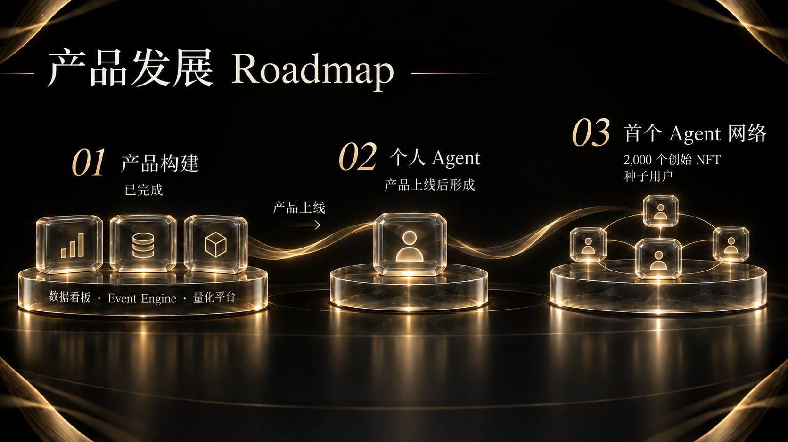

# 15. 产品发展 Roadmap

DI 的发展顺序是：完成产品构建，产品上线后形成个人 Agent，再由创始 NFT 对应的种子用户建立首个 Agent 网络。

| 阶段 | 状态／触发条件 | 主要内容 |
| --- | --- | --- |
| 01 产品构建 | 已完成 | 数据看板、Event Engine、量化产品与策略创建工具 |
| 02 个人 Agent | 产品上线后 | 连接数据、推演与量化能力，结合用户偏好处理持续金融任务 |
| 03 首个 Agent 网络 | 种子用户阶段 | 以 2,000 个创始 NFT 对应的种子用户形成首个互通网络 |

## 01 产品构建

数据看板、Event Engine、量化产品与策略创建工具的构建已完成，覆盖信息发现、事件分析和策略创建。下一步推进产品正式上线。

这一阶段为后续 Agent 提供数据、推演与量化工具基础。

## 02 形成个人 Agent

产品上线后，DI 将把三类能力连接到个人 Agent，结合用户偏好，持续跟踪市场并处理金融任务。

重点从单次操作转向持续任务：让研究上下文能够保留，让新信息能够触发进一步分析，让不同产品在用户授权下衔接。

## 03 建立首个 Agent 网络

以 2,000 个创始 NFT 对应的种子用户建立首个网络，让这些用户的 Agent 交换信息、调用能力和协作完成任务。

创始 NFT 对应的种子用户将参与初期网络建设，围绕真实任务建立信息交换与能力协作。

