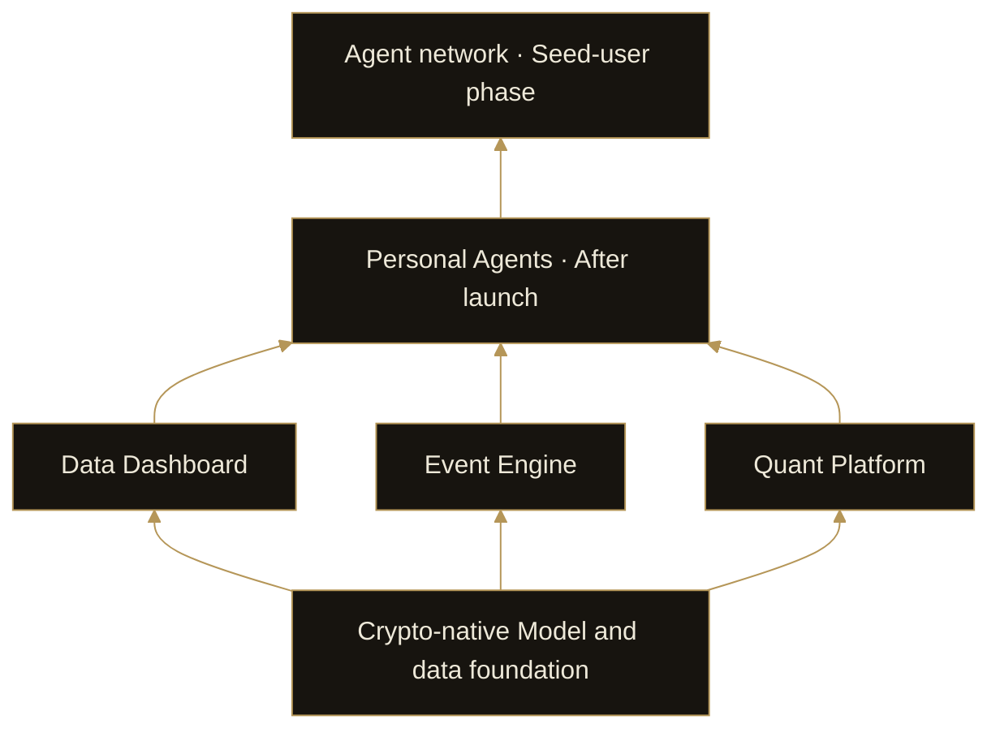

# 3. Product Architecture

DI’s architecture connects a common model foundation, three product capabilities, and subsequent Personal Agent and Agent network stages. The model supplies the shared foundation; products perform specific work; Personal Agents organize capabilities around user tasks; the network connects Agents belonging to different users.

## One foundation, three products

The Data Dashboard, Event Engine and Quant Platform perform different work while sharing a crypto market data and model foundation. They are connected capabilities, rather than unrelated entry points or a sequence that every user must complete in order.

The dashboard can be used independently for discovery. Event Engine can start with a question entered directly by a user. The Quant Platform provides both DI products and tools for users to create and publish strategy products.

## Personal Agents as the user’s interface

In the next stage, a Personal Agent will call these capabilities according to the task. A task may require only data monitoring, or combine event research with strategy analysis. The Agent organizes the work and its context while relying on the underlying products.

## A network across users

The Agent network will develop after Personal Agents take shape. Its central relationships are communication, information exchange, capability calls and collaborative tasks between Agents.

Multi-persona discussion inside Event Engine is a research workflow within one product. The financial Agent network connects Agents that serve different users over time. These scopes can share capabilities but are distinct.

The diagram describes product relationships and the development direction. It is not a list of live services or a deployment topology.
