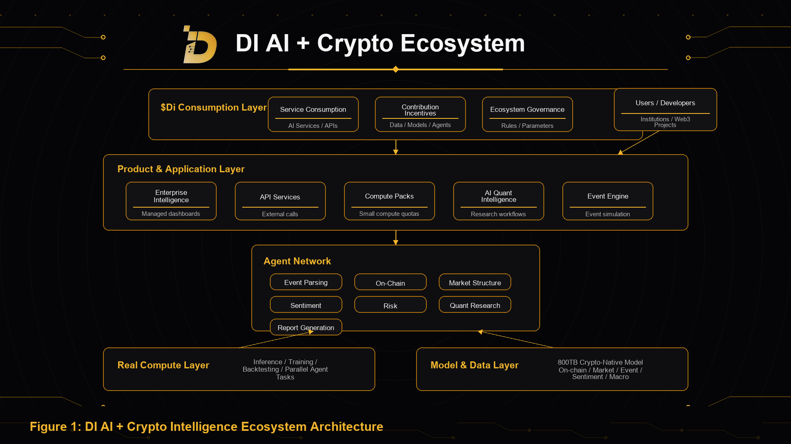

DI's ecosystem architecture consists of six components: users and ecosystem participants, the product and application layer, Agent Network, the model and data layer, the real compute layer, and the ecosystem consumption and coordination mechanism that runs across the system.

## Users and Ecosystem Participants

DI is open to multiple user types, including ordinary users, developers, researchers, trading teams, Web3 projects, institutional customers, data contributors, model contributors, and Agent builders.

Different roles use DI through different entrances. Ordinary users can use Event Engine to launch event simulations. Researchers can use AI Quant Intelligence for market structure research. Developers can build applications through APIs and Compute Packs. Projects and institutions can access Enterprise Intelligence. Ecosystem contributors can provide data, models, agents, and historical reviews.

## Product and Application Layer

The product and application layer turns underlying capabilities into usable products.

This layer includes Event Engine, AI Quant Intelligence, Compute Packs, API Services, and Enterprise Intelligence. They serve event simulation, quantitative research, compute consumption, developer access, and institutional needs.

## Agent Network

Agent Network is DI's intelligent coordination layer.

Complex events usually cannot be handled by a single model in one pass. Agent Network assigns tasks to specialized agents such as event parsing agents, on-chain analysis agents, market structure agents, sentiment and narrative agents, macro analysis agents, risk evaluation agents, quantitative research agents, and report generation agents.

These agents can execute in parallel and cross-validate results to produce more complete intelligence.

## Model and Data Layer

The model and data layer is supported by the 800TB crypto-native model.

This model is not a simple pile of general data. It is built from crypto-native data and structured context accumulated around on-chain behavior, market data, historical events, project data, sentiment narratives, macro variables, security incidents, and cross-market signals.

## Real Compute Layer

The real compute layer is the foundation of DI.

It supports model inference, training, backtesting, data processing, historical retrieval, parallel agent tasks, API calls, and enterprise intelligence services. DI delivers compute through productized services instead of making compute itself the only product narrative.

## Ecosystem Consumption and Coordination

The ecosystem consumption and coordination mechanism connects service usage, resource input, contribution incentives, and governance collaboration.

As DI's products and developer ecosystem expand, the system will form a long-term loop around real service consumption, verified contribution records, and real ecosystem collaboration.
