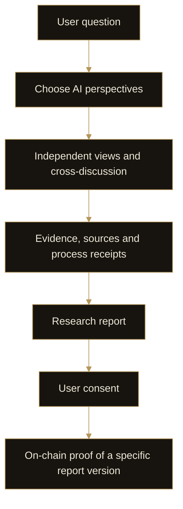

# 6. Event Engine

Event Engine starts with a question about markets, macro conditions or crypto assets. AI personas examine it from different analytical perspectives, retaining the evidence, disagreements and process. The output is a research report whose development can be reviewed.

## Multi-perspective research

After posing a question, users can select AI personas for the discussion. These personas simulate KOL styles and analytical perspectives, bringing different priorities and interpretations to the same question. This does not imply participation or endorsement by the KOLs themselves.

The process includes independent views and cross-discussion. It preserves both areas of agreement and unresolved differences, rather than removing uncertainty to produce a single answer.

## Evidence and process receipts

Citations retain their sources and distinguish facts, inferences and unverified claims. Process receipts and stage records help users review what each step produced and how the research developed into a report.

A receipt records a process; a citation identifies evidence. Neither alone proves that a judgment is correct. Together, they make research reviewable instead of presenting an untraceable result.

## The research report

The report brings together judgments, effects by stage, risks and invalidation conditions. Invalidation conditions identify changes that would require an assessment to be reconsidered, allowing users to revisit research as events develop.

Different perspectives may reach opposing interpretations. The report should show what supports each position and which information is still missing, helping users understand the limits of a conclusion.

## Consent and on-chain proof

With user consent, proof of a specific report version can be anchored on-chain. The report itself and private discussion remain off-chain. The record supports verification of the version proof and its associated record; it neither publishes all research content nor proves prediction accuracy or realized returns.
