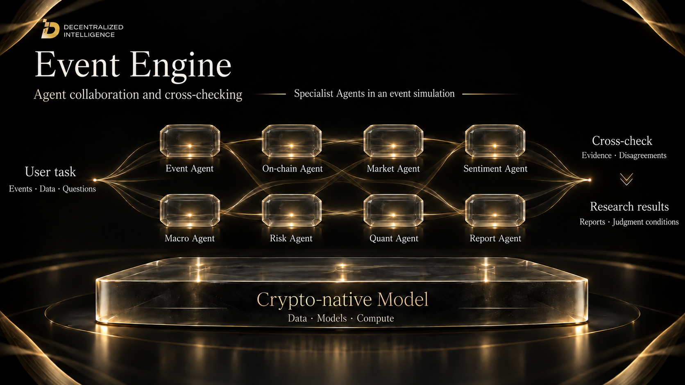
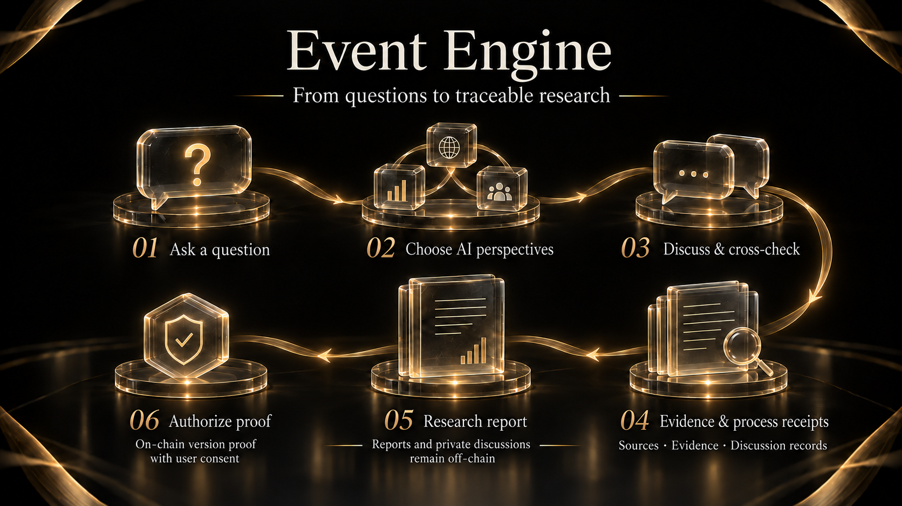

# 6. Event Engine

Event Engine starts with a question about markets, macro conditions or crypto assets. AI personas examine it from different analytical perspectives, retaining the evidence, disagreements and process. The output is a research report whose development can be reviewed.

## Multi-perspective research

After posing a question, users can select AI personas for the discussion. These personas simulate KOL styles and analytical perspectives, bringing different priorities and interpretations to the same question. This does not imply participation or endorsement by the KOLs themselves.

The process includes independent views and cross-discussion, preserving agreement, disagreement and uncertainty.

## Specialist Agents and cross-checking

An event simulation can divide research across event context, on-chain activity, market structure, sentiment, macro conditions, risk and quantitative analysis. A report Agent brings the findings together. Agents exchange information and compare sources, retaining different interpretations and judgment conditions.

## Evidence and process receipts

Citations retain their sources and distinguish facts, inferences and unverified claims. Process receipts and stage records help users review what each step produced and how the research developed into a report.

Process receipts record research steps, while citations identify supporting evidence. Together, they let users review how a report developed.

## The research report

The report brings together judgments, effects by stage, risks and invalidation conditions. Invalidation conditions identify changes that would require an assessment to be reconsidered, allowing users to revisit research as events develop.

Different perspectives may reach opposing interpretations. The report presents the evidence behind each position and identifies information gaps, helping users understand the limits of a conclusion.

## Consent and on-chain proof

With user consent, proof of a specific report version can be anchored on-chain. The report itself and private discussion remain off-chain. The on-chain record enables verification of proof for the selected version.
