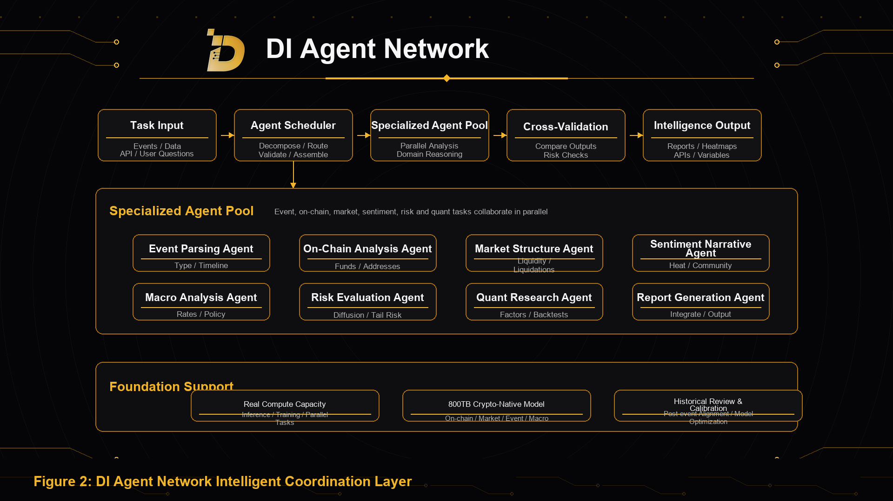

Agent Network is DI's coordination layer for turning complex tasks into executable intelligence workflows.

In crypto markets, a single model can rarely handle event understanding, on-chain analysis, market structure judgment, sentiment detection, macro analysis, risk evaluation, quantitative research, and report generation at the same time. DI decomposes these tasks across specialized Agents and coordinates them through a unified workflow.

## Agent Types

DI's Agent Network can include:

- Event Parsing Agent: identifies event type, time window, participants, direct impact, and potential transmission paths;
- On-Chain Analysis Agent: analyzes fund flows, address behavior, protocol interactions, stablecoin movement, and abnormal on-chain activity;
- Market Structure Agent: analyzes liquidity, leverage, derivatives, liquidation risk, order books, and correlations;
- Sentiment and Narrative Agent: identifies news, social media, community discussion, and market narrative shifts;
- Macro Analysis Agent: analyzes rates, dollar liquidity, geopolitics, regulation, and the risk-asset environment;
- Risk Evaluation Agent: evaluates tail risks, diffusion paths, sensitive assets, and key monitoring indicators;
- Quantitative Research Agent: turns event variables into research factors, backtesting objects, and monitoring indicators;
- Report Generation Agent: integrates multi-agent outputs into reports, matrices, heatmaps, and API-ready results.

## Collaboration Method

Agent Network works through task decomposition, parallel execution, cross-validation, and result integration.

In Event Engine, the system first structures the event, then assigns different tasks to corresponding Agents. After each Agent analyzes independently, the system aligns outputs, identifies conflicts, adjusts weights, and produces final intelligence.

This mechanism allows DI to process multiple dimensions of complex market events at the same time.

## Continuous Evolution

Agent Network evolves with data, models, products, and ecosystem contributions.

New Agents can expand into stablecoins, exchanges, RWA, DeFi, Layer2, NFT, GameFi, security, regulation, macro, and multilingual sentiment. Contributors can also build specialized Agents based on DI's framework so DI can cover more market scenarios.
