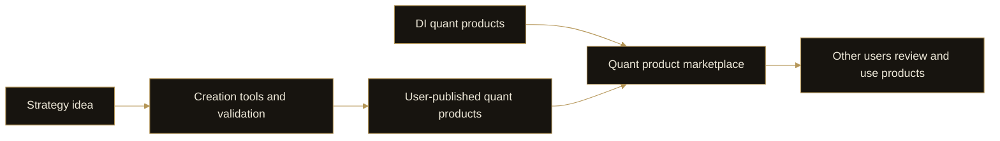

# 7. Quant Platform

DI’s Quant Platform connects strategy research, product creation and product use. It offers DI’s own quant products and tools that let users turn their strategies into products and publish them for others.

## DI quant products

Users can examine a DI product’s strategy, performance and risks before deciding whether it fits their needs. Dynamic Baskets are one product category; the platform is not limited to a single strategy.

Product descriptions should distinguish objectives, rules and actual performance. An objective is not an achieved track record, and historical results do not establish future outcomes.

## User creation and publication

Strategy creation tools help users express ideas as rules that can be researched and tested. Creators can examine data, variables and strategy conditions before presenting a product that others can understand and use.

A published product needs more than a return figure. Users need to understand what the strategy does, the conditions it relies on and the risks it faces. Creators also need to observe performance over time and explain how results relate to the rules.

## The product marketplace

The marketplace brings together products from DI and other creators. Users can review strategy descriptions, performance and risks before choosing a product. The platform’s value comes from its own products and from enabling more strategies to become usable products.

The platform receives an agreed share of quant product profits. Participation, fees and usage conditions depend on the individual product. This whitepaper sets no universal return target and does not treat illustrative interface data as actual performance.

## Connecting research and strategies

The Data Dashboard supplies market leads. Event Engine develops scenarios and judgment conditions. Quant tools help users examine whether those conditions can become strategy rules. Event research and strategy results can inform each other, but a research conclusion is not automatically an executable strategy.
