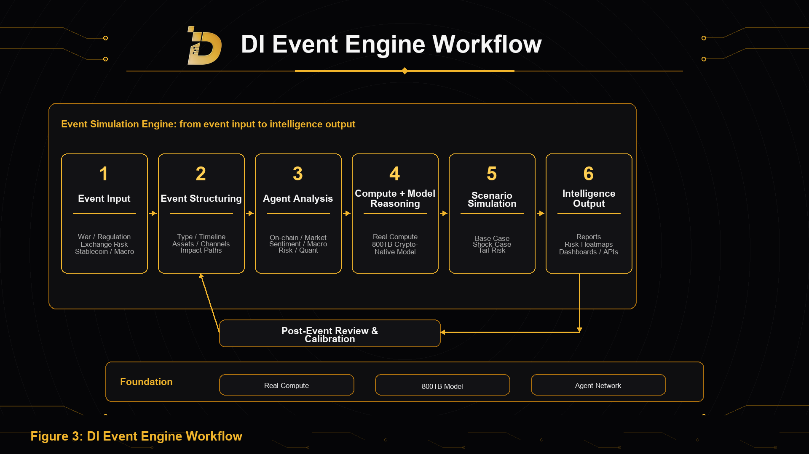

Event Engine is DI's first flagship product entrance and the core scenario where DI turns real compute, the 800TB crypto-native model, and Agent Network into user-facing intelligence services.

It combines real compute capacity, the 800TB crypto-native model, and Agent Network to analyze complex crypto market events and output structured event simulations, risk analysis, and intelligence results.

Event Engine is the first concentrated product expression of DI's ecosystem capabilities. It shows how DI turns compute, native data, model reasoning, and Agent coordination into usable AI products.

## Event Input

Event Engine supports both user-initiated input and system-detected event signals.

Users can ask questions about past, ongoing, or hypothetical events, such as:

- how a regional war may affect BTC, ETH, stablecoins, and risk assets;
- how risk may spread after a major exchange liquidity crisis;
- which indicators should be monitored when stablecoin depeg signals appear;
- which sectors may be affected after a country releases new crypto regulations;
- what risks related chains and protocols may face after a cross-chain bridge attack.

The system can also detect potential market anomalies and event signals from news, on-chain data, exchange data, stablecoin flows, derivatives indicators, social sentiment, and security incident monitoring.

## Event Structuring

After an event enters the system, Event Engine first structures it.

The system identifies event type, time window, involved regions, related assets, related protocols or institutions, direct impact paths, indirect transmission paths, key monitoring indicators, and potential risk levels.

The goal is to turn a vague event into a task that can be processed by Agent Network, models, and compute.

## Agent Analysis

After event structuring, Agent Network conducts parallel analysis across different dimensions.

Event Parsing Agent decomposes the event itself. On-Chain Analysis Agent observes fund flows and address behavior. Market Structure Agent analyzes liquidity, leverage, and liquidation risk. Sentiment and Narrative Agent identifies market emotion and narrative spread. Macro Analysis Agent evaluates rates, dollar liquidity, regulation, and geopolitical impact. Risk Evaluation Agent identifies tail risks and transmission paths. Quantitative Research Agent turns event variables into research indicators. Report Generation Agent integrates outputs.

This multi-agent coordination allows Event Engine to generate more complete event intelligence through multi-dimensional analysis and cross-validation.

## Compute and Model Reasoning

Event Engine is supported by real compute capacity and the 800TB crypto-native model.

Real compute is used for model inference, parallel Agent execution, data processing, historical event retrieval, scenario simulation, and report generation. The 800TB crypto-native model provides crypto market context, including on-chain behavior, market structure, historical events, project data, sentiment narratives, macro variables, and cross-market information.

## Multi-Scenario Simulation

Event Engine does not rely on a single output path. It simulates multiple scenarios.

Common scenarios include base case, shock case, severe case, and tail-risk case.

For example, in a geopolitical conflict scenario, the system can analyze different paths such as mild conflict, escalation, macro-market linkage, and sentiment deterioration, and evaluate how BTC, ETH, stablecoins, gold-narrative assets, and risk assets may react.

This helps users understand risk paths and variable changes across different scenarios.

## Intelligence Output

Event Engine directly outputs event simulation reports, risk heatmaps, asset impact matrices, key monitoring indicators, and dynamic dashboards.

For developers and institutional customers, these capabilities can also be integrated through API Services or Enterprise Intelligence into external systems, research workflows, risk dashboards, and enterprise workflows. Event Engine is the product entrance for event intelligence, while API Services and Enterprise Intelligence are distribution and integration entrances.

## Post-Event Review and Model Calibration

After an event ends, DI conducts post-event review.

The system compares real market performance with previous simulation results, evaluates which judgments were useful, which paths deviated, which data sources or Agents performed more steadily, and which model weights or scenario templates need adjustment.

Review results are used to optimize data-source weights, model parameters, Agent performance, scenario templates, risk thresholds, and event classification systems.

This makes Event Engine a continuously evolving event intelligence system.
