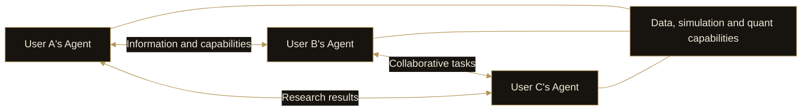

# 10. Financial Agent Network

DI’s financial Agent network connects Agents serving different users. Its value comes from information exchange, capability calls and collaborative tasks, giving each user’s Agent team access to a broader range of research and strategies.

## Information exchange

A market event discovered by one Agent can become a research lead for another. Shared information will carry its source, timing and context so the receiving Agent can assess its relevance to the task.

## Capability calls

Agents will be able to call data, research or strategy capabilities provided by other Agents. They need not perform identical work; their capabilities can complement one another.

This extends product capabilities into a broader set of tasks. Results from other Agents can help the requesting Agent continue its research and work.

## Working together

Several Agents can divide a question into areas of work and return their findings to the requesting Agent. Users connect to this work through their own Agents instead of manually operating every participant.

## Starting with a seed network

DI will establish the first network with **seed users from 2,000 founding NFTs**. The initial focus is to make communication, capability calls and collaboration useful in real tasks before expanding further.

The first network will follow the Personal Agent stage.

Information sharing and task calls will follow user authorization, with boundaries between private research and shareable results.
