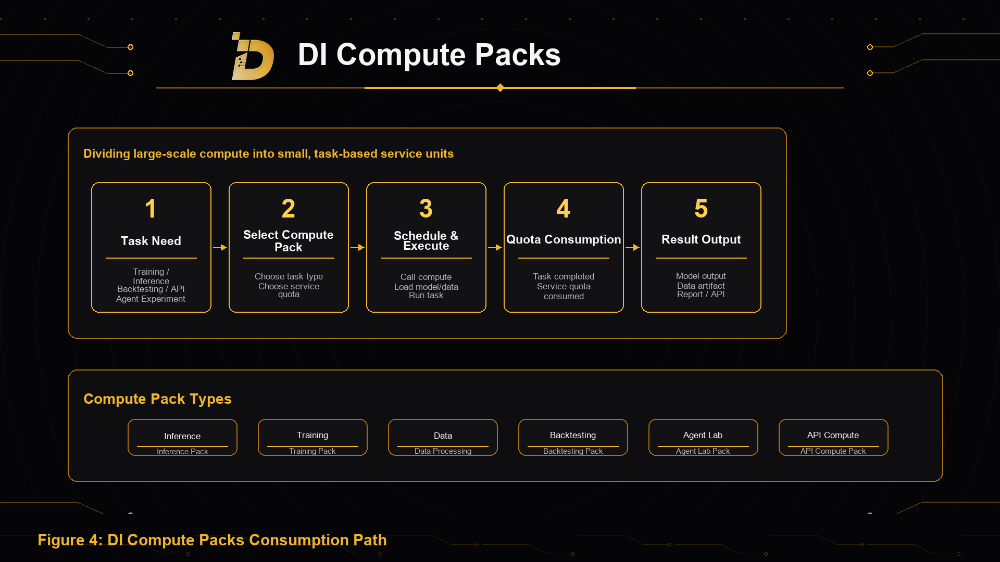

Compute Packs are small compute service quotas for developers, researchers, AI builders, small teams, and advanced individual users with specific task needs.

Compute Packs divide real compute capacity into small service units that are purchasable, understandable, executable, and consumable, lowering the barrier to AI compute access.

In traditional settings, AI compute is often delivered through large servers, cloud resources, complex billing, long-term rental, or enterprise services. For individual researchers, developers, small teams, and early projects, direct access is difficult.

DI lowers this barrier through Compute Packs.

Users do not need to understand complex compute scheduling or rent large-scale resources over a long period. They select a compute pack based on a task, and the system handles scheduling, execution, and consumption.

## What Compute Packs Are

Compute Packs are consumable compute service quotas.

Each Compute Pack corresponds to one or more task capabilities, such as model inference, model training, data processing, quantitative backtesting, Agent experiments, or API calls.

After purchasing a Compute Pack, users can use it to complete specific compute tasks. When the task is completed, the corresponding service quota is consumed.

For example, an inference pack can complete a batch of model inference tasks. A training pack can support small model training or fine-tuning. A data processing pack can clean, index, or analyze a dataset. A backtesting pack can run a quantitative research backtest. An Agent lab pack can test a multi-agent workflow. An API compute pack can support a certain amount of API-call tasks.

## Difference From Event Engine

Compute Packs and Event Engine serve different user paths.

Compute Packs are not the payment method for Event Engine users, and ordinary Event Engine users do not need to understand the underlying compute resources.

Event Engine users purchase managed AI event intelligence results. They pay for a service task and receive reports, risk heatmaps, asset impact matrices, monitoring indicators, or dynamic dashboards without selecting compute specifications.

Compute Packs users purchase compute quotas that can be used for training, inference, data processing, backtesting, Agent experiments, or batch API tasks.

Compute Packs are designed for individual researchers, developers, small teams, AI builders, and Web3 projects that want to use part of DI's compute capability for their own tasks.

## Usage Flow

Compute Pack usage has five steps.

First, the user submits a task requirement, such as model inference, small training, data cleaning, quantitative backtesting, Agent workflow experiments, or batch API calls.

Second, the system provides different Compute Pack types based on task category.

Third, after confirmation, DI schedules underlying compute and loads relevant data, models, Agents, or API services as required.

Fourth, the task consumes the corresponding service quota during execution.

Fifth, after completion, the user receives outputs such as model results, processed data, backtest results, Agent experiment results, reports, or API data.

## Compute Pack Types

DI can design multiple Compute Pack types:

- Inference Pack: model inference, text analysis, event summaries, market interpretation, report generation, and API inference;
- Training Pack: small model training, fine-tuning, parameter optimization, or model experiments on specific datasets;
- Data Processing Pack: data cleaning, format conversion, indexing, label generation, on-chain data processing, and historical event structuring;
- Backtesting Pack: quantitative research, event factor testing, strategy research, stress testing, and risk exposure analysis;
- Agent Lab Pack: building, testing, and running multi-agent workflows;
- API Compute Pack: developer API calls, batch task execution, automation workflows, and third-party application integration.

## Product Value

Compute Packs lower the barrier to AI compute.

They allow users to use small compute services based on specific tasks, without buying or renting complex compute resources or dealing with enterprise infrastructure configuration.

This is valuable for individual researchers, independent developers, small quant teams, Web3 projects, AI Agent builders, security research teams, data contributors, and early ecosystem developers.

Compute Packs are small, task-based, and consumable AI compute service quotas.
