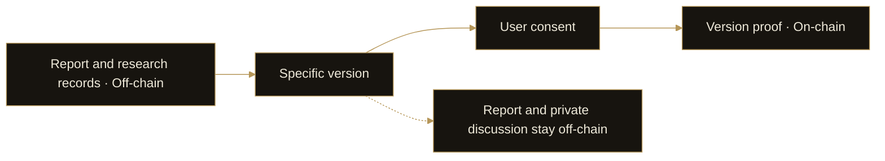

# 11. Contributions, Receipts & Proof

DI treats research content, process records and on-chain proof as distinct elements. This allows users to review research and, with consent, create a verifiable record for a specific version without publishing all private discussion.

## Three different records

| Record | Main content | Purpose |
| --- | --- | --- |
| Research evidence | Sources, citations, facts and unverified claims | Examining the basis for an argument |
| Process receipts | Stage results and process acknowledgments | Reviewing how the research developed |
| Version proof | An on-chain record associated with a specific report version | Verifying the relationship between a record and a version |

## From research to consent-based proof

A user first receives the report and its research records, then chooses whether to authorize contribution and on-chain proof. Consent identifies a specific report version, keeping later edits distinct from the earlier record.

The report and private discussion remain off-chain. The on-chain record contains proof associated with the selected version, with the corresponding transaction or record information available for verification.

## Valuable contributions

Contributions can include material valuable to DI’s data, models and products, as well as research, external quant strategies and product collaboration. Verified contribution rewards are for validated contributions, with eligibility determined by contribution assessment and applicable rules.

On-chain proof verifies a version record. Contribution assessment considers the content’s value, source quality and applicable product rules.

## Preserving context

Research sharing follows user authorization, separating public content from private information. Future Agent collaboration will retain these boundaries, permissions and source relationships when exchanging research results.
