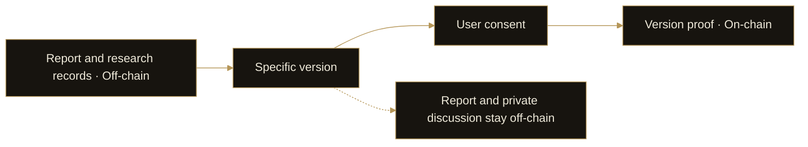

# 11. Contributions, Receipts & Proof

DI treats research content, process records and on-chain proof as distinct elements. This allows users to review research and, with consent, create a verifiable record for a specific version without publishing all private discussion.

## Three different records

| Record | Main content | Purpose |
| --- | --- | --- |
| Research evidence | Sources, citations, facts and unverified claims | Examining the basis for an argument |
| Process receipts | Stage results and process acknowledgments | Reviewing how the research developed |
| Version proof | An on-chain record associated with a specific report version | Verifying the relationship between a record and a version |

These records answer different questions. Source truth, process completeness and the existence of a version record cannot substitute for one another.

## From research to consent-based proof

A user first receives the report and its research records, then chooses whether to authorize contribution and on-chain proof. Consent should refer to a specific report version so that later edits are not confused with an earlier record.

The report and private discussion remain off-chain. The on-chain record contains proof associated with the selected version, with the corresponding transaction or record information available for verification. Submission methods and supported scope depend on the product functionality.

## Valuable contributions

Contributions can include material valuable to DI’s data, models and products, as well as research, external quant strategies and product collaboration. Verified contribution rewards are for validated contributions. Submitting content, generating a receipt or obtaining a transaction hash does not automatically complete a reward.

On-chain proof can support verification of a version record. It cannot independently establish contribution quality, source truth or analytical correctness. Contribution assessment also depends on the content and applicable product rules.

## Preserving context

Research sharing should distinguish public content from private user information. Future Agent collaboration should maintain these boundaries so that the network can exchange useful results while retaining permissions and source relationships.
