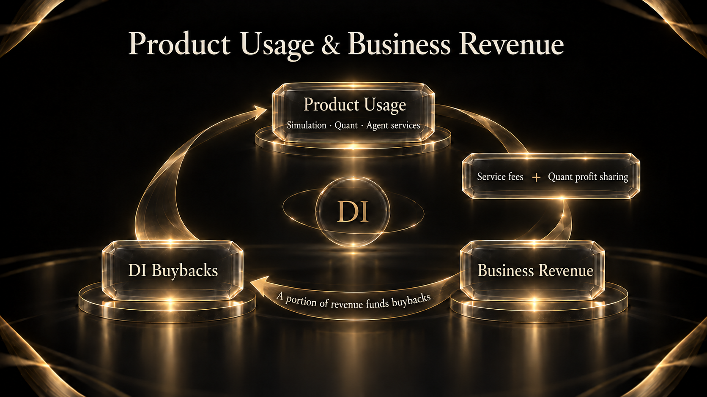

# 14. Business Model

DI’s business model generates service revenue through product usage and adds revenue through quant product profit sharing. A portion of business revenue funds DI buybacks.

## Where revenue comes from

Event Engine simulations, Personal Agent tasks and tool calls, and network services and collaborative tasks create service-payment use cases. These revenue sources develop as the corresponding products and service stages become available.

Quant products provide another source: the platform receives an agreed share of product profits. Profit sharing depends on product performance and the applicable agreement.

Holding DI provides dashboard access; business revenue comes from service payments and quant product profit sharing.

## Product usage and buybacks

This mechanism connects demand for products with business revenue. Continued usefulness, users’ willingness to use services and the ability of quant products to generate shareable profits affect that revenue.

## Revenue use cases across product stages

DI has completed product development and is preparing for launch. Simulations and quant products form the initial business foundation; Personal Agents and the network will add payment use cases for tasks, tool calls and collaborative services.
