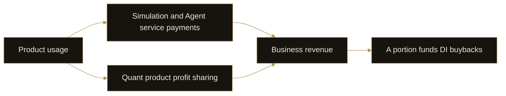

# 14. Business Model

DI’s business model generates service revenue through product usage and adds revenue through quant product profit sharing. A portion of business revenue funds DI buybacks.

## Where revenue comes from

Event Engine simulations, Personal Agent tasks and tool calls, and network services and collaborative tasks create service-payment use cases. These revenue sources develop as the corresponding products and service stages become available.

Quant products provide another source: the platform receives an agreed share of product profits. Unlike a fixed service fee, profit sharing depends on product performance and the applicable agreement. Offering capacity alone cannot be used to calculate revenue.

Dashboard holding requirements are an access mechanism. The total value of DI held by eligible users is not platform revenue.

## Product usage and buybacks

This mechanism connects demand for products with business revenue. Continued usefulness, users’ willingness to use services and the ability of quant products to generate shareable profits affect that revenue.

## Stages and disclosure

The current focus is completed product development and subsequent launch. Personal Agent and network revenue use cases depend on delivery of those stages and are not presented as existing revenue.

This whitepaper describes revenue structure without asserting undisclosed revenue, buyback volumes or earnings forecasts. Demonstration figures for product capacity and returns are not evidence of business revenue.

As operations develop, service usage, product performance and actual buybacks should be disclosed separately. Transaction counts, campaign participation and source coverage should not be treated as revenue.
