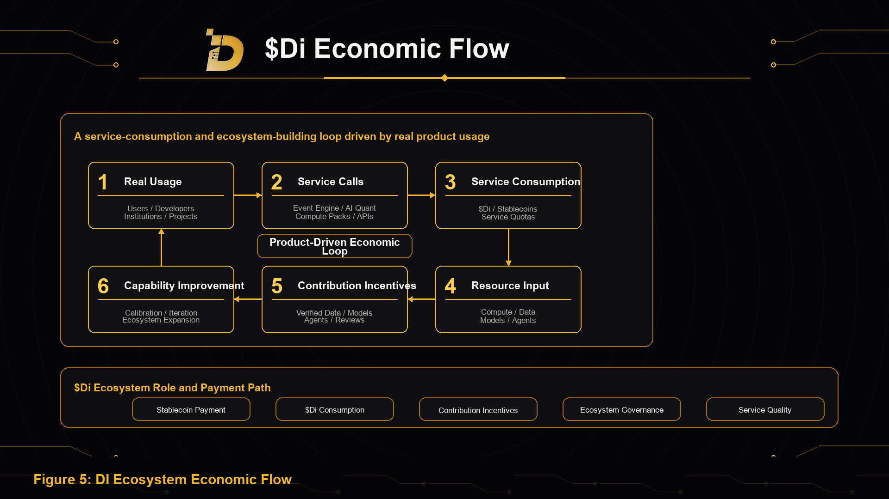

DI's economic flow mechanism is built around real service consumption, compute resource input, contribution incentives, ecosystem governance, and long-term treasury management.

DI's business loop begins with real product usage. Users generate service consumption through Event Engine, AI Quant Intelligence, Compute Packs, API Services, and Enterprise Intelligence. Service consumption creates resource feedback that supports compute, data, models, Agents, product R&D, and ecosystem tasks. Stronger underlying capabilities create better product experience and more verifiable contribution scenarios.

## Dual Payment Paths

DI supports two payment paths: stablecoins and $Di.

Stablecoin payment lowers the access barrier for ordinary users, enterprise customers, developers, and institutions. $Di payment strengthens the native ecosystem consumption path, linking service usage, ecosystem incentives, and governance collaboration more closely.

Both payment paths serve the same goal: making DI's AI products and compute capabilities truly used.

## Stablecoin Resource Inflow Path

Stablecoin resource inflow mainly comes from Event Engine, AI Quant Intelligence, Compute Packs, API Services, Enterprise Intelligence, data services, model services, and customized reports.

These resources support DI's long-term construction, including compute costs, model training, data procurement, R&D, ecosystem collaboration, market expansion, security, and the Foundation treasury.

## $Di Consumption Path

$Di consumption mainly comes from internal ecosystem service usage.

Users consume $Di for Event Engine tasks, Compute Packs, API calls, Agent services, model services, data services, and enterprise modules. Related service consumption forms system resource feedback that supports ongoing input into compute, models, data, products, and ecosystem tasks.

As the product matrix expands, $Di consumption scenarios will expand from a single product to a multi-product, multi-developer, and multi-participant usage network.

## Contribution Incentive Path

DI will allocate ecosystem incentives around real contributions.

Contributors can participate through data contribution, model optimization, Agent building, historical review, security feedback, developer tools, ecosystem applications, and enterprise integration.

Contribution incentives will be related to contribution quality, usage effect, long-term value, and system improvement.

## Ecosystem Treasury

The Foundation long-term treasury supports DI's long-term development.

The treasury can be used for compute input, model R&D, data procurement, ecosystem incentives, partner building, developer funds, security audits, market expansion, and long-term reserves.

Treasury management will gradually introduce multisig, permission layers, transparent disclosure, and governance collaboration mechanisms.

## Economic Loop

DI's economic loop can be summarized as follows:

Users consume products. Service consumption creates operating resource inflow and resource demand. Resources support compute, data, models, and product building. Ecosystem contributors provide data, models, Agents, tools, and reviews. The system incentivizes high-quality contributions. Stronger underlying capability creates better product experience. Better product experience drives more service consumption.

The foundation of this loop is real products, real compute, real data, and real ecosystem contributions.
