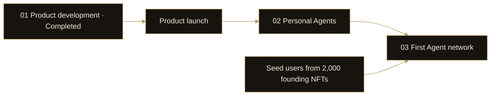

# 15. Product Roadmap

DI’s development sequence is to complete the products, form Personal Agents after product launch, and establish the first network with seed users from the founding NFTs.

| Stage | Status / dependency | Focus |
| --- | --- | --- |
| 01 Product development | Completed | Data Dashboard, Event Engine, quant products and strategy creation tools |
| 02 Personal Agents | After product launch | Connect data, simulation and quant capabilities around ongoing user tasks |
| 03 First Agent network | Seed-user phase | Establish an interconnected network with seed users from 2,000 founding NFTs |

## 01 Product development

Development of the Data Dashboard, Event Engine, quant products and strategy creation tools is complete, covering discovery, event analysis and strategy creation. Completing development and launching products are separate stages.

This stage supplies the practical tools that later Agents will use. An Agent concept cannot replace products that users can actually use.

## 02 Personal Agents

After launch, DI will connect the three capabilities through Personal Agents, using user preferences to monitor markets and work on financial tasks.

The focus moves from individual operations to ongoing work: retaining research context, using new information to support further analysis and connecting products under user authorization.

## 03 The first Agent network

Seed users from 2,000 founding NFTs will form the first network. Their Agents will exchange information, call capabilities and collaborate on tasks.

The founding NFTs provide a seed participation base. The network’s practical value depends on useful collaboration around tasks, information and capabilities. NFT counts do not equal unique users or active Agents.

This roadmap follows product dependencies and stages without assigning undisclosed launch dates.
